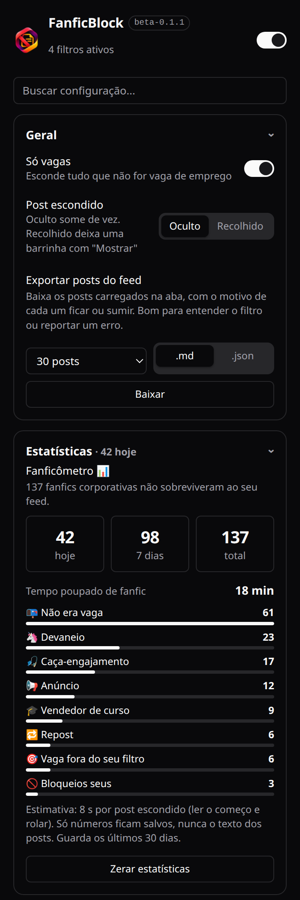

<div align="center">


# FanficBlock

**Chega de fanfic corporativa.**
Uma extensão do Chrome que tira do feed do LinkedIn o coach quântico, o
"fui demitido e agradeci", o "comenta EU" e o textão de ego, e deixa só as
vagas que fazem sentido pra você.


[Site](https://kyotodevindie.github.io/fanficblock/) ·
[Instalar](#-instalar) ·
[O que ele barra](#-o-que-ele-barra) ·
[Privacidade](#-privacidade) ·
[Contribuir](CONTRIBUTING.md) ·
[Apoiar](#-apoie-o-projeto)

</div>

---



## 🦄 O problema

Você abre o LinkedIn atrás de vaga e encontra:

- a lição de liderança que alguém aprendeu com o cachorro;
- o "comenta GUIA que eu te mando no privado";
- o curso de R$ 997 com "vagas limitadas";
- o anúncio, o repost do repost, o parabéns pelos 7 anos de empresa...

E a vaga que você queria? Lá embaixo, se tiver sorte.

## ✨ O que o FanficBlock faz

- **Só vagas:** esconde tudo que não é vaga de emprego, com um modo extra
  que só deixa vaga postada por recrutador.
- **Barra a fanfic:** devaneio motivacional, caça-engajamento, vendedor de
  curso, post patrocinado e repost.
- **Filtra a vaga do seu jeito:** tecnologia, senioridade, modelo (remoto,
  híbrido, presencial), contratação, localização, salário mínimo, anos de
  experiência, empresas bloqueadas e favoritas.
- **Gerador de query:** escolha tecnologia, senioridade, modelo,
  contratação, local e o que excluir, e ele monta a query booleana do
  LinkedIn (`(React OR Node) AND pleno NOT estágio`) e coloca direto no campo
  de busca. É só apertar Enter.
- **Fanficômetro 📊:** quantas fanfics você deixou de ler hoje, na semana e
  no total, e quanto tempo isso te poupou.
- **Você decide:** o post some de vez ou vira uma barrinha com "Mostrar".
  Mostrou e se arrependeu? "Esconder de novo".

<br clear="right">

## 🚀 Instalar

> Em breve nas lojas. Por enquanto, instale direto do código (leva 1 minuto).

1. Baixe o projeto: botão verde **Code → Download ZIP** (e descompacte) ou
   ```bash
   git clone https://github.com/kyotodevIndie/fanficblock.git
   ```
2. Abra `chrome://extensions`.
3. Ligue o **Modo do desenvolvedor** (canto superior direito).
4. Clique em **Carregar sem compactação** e escolha a pasta do projeto.
5. Abra o feed do LinkedIn. Pronto: clique no ícone do FanficBlock pra
   ajustar os filtros.

Funciona no Chrome e nos navegadores baseados nele (Edge, Brave, Opera, Arc).

## 🎯 O que ele barra

| Categoria | Exemplo | Derruba vaga? |
| --- | --- | --- |
| 📭 Não era vaga | "Hoje completei 7 anos de empresa" | — |
| 🦄 Devaneio | "Fui demitido e agradeci. Lição de liderança." | Só com frase forte |
| 🎣 Caça-engajamento | "Comenta EU que eu te mando" | Nunca |
| 🎓 Vendedor de curso | "Mentoria por R$ 997, últimas vagas" | Nunca |
| 📢 Anúncio | Post "Promovido" | Sim |
| 🔁 Repost | "Fulano republicou isso" | Nunca (repost de vaga fica) |
| 🚫 Seus bloqueios | Autor, empresa, domínio ou palavra que você bloqueou | Sim |
| 🎯 Vaga fora do filtro | Vaga sênior quando você quer pleno | — |

Algumas regras guiam o filtro:

- **Na dúvida, a vaga fica.** Esconder uma vaga boa é pior do que deixar
  passar uma fanfic.
- **O que a vaga não diz conta como desconhecido, não como "não".** Vaga sem
  salário não cai pelo salário mínimo, e vaga sem local não cai pela
  localização. Só as opções "exigir" escondem por falta de informação.
- **O FanficBlock nunca afirma** que um post é inventado, escrito por IA ou
  vaga fantasma. Ele só diz por que escondeu.

O passo a passo de cada filtro e a ordem em que as regras decidem estão em
[docs/COMO-FUNCIONA.md](docs/COMO-FUNCIONA.md).

## 🔒 Privacidade

- **Tudo roda no seu navegador.** Nenhum post, nome ou clique sai do seu
  computador: não tem servidor, analytics nem rastreador.
- **Só a permissão `storage`**, pra lembrar das suas configurações.
- **As estatísticas guardam só números:** nunca o texto dos posts. São no
  máximo 30 dias e 1000 hashes curtos, só pra não contar o mesmo post duas
  vezes.

Os detalhes estão na [política de privacidade](PRIVACY.md).

## 🗺️ Roadmap

- [x] **Fase 1:** patrocinados, caça-engajamento, reposts, autores bloqueados
  e liberados, painel com busca e contador.
- [x] **Fase 2, vagas avançadas:** localização, salário, empresas,
  tecnologias, anos de experiência, vendedor de curso, domínios, vaga
  incompleta ou repetida, gerador de query e Fanficômetro.
- [ ] **Fase 3, identidade:** categorias de fanfic (Síndrome do protagonista,
  Coach quântico corporativo, Mendigo de engajamento, Humildade premium,
  Fanfic de recrutamento, Conteúdo genérico de IA), presets (Caça-Vagas,
  Antifanfic, Dev, Paz Interior) e estatísticas compartilháveis como imagem.
- [ ] **Fase 4, refinamento:** modo de teste, exportar e importar
  configurações, backup e otimizações.
- [ ] Ler o texto alternativo de imagens (hoje, vaga que é só print some).

## 🤝 Contribuir

Achou uma fanfic que passou? Uma vaga que sumiu sem motivo? Quer um filtro
novo? Toda ajuda é bem-vinda, inclusive de quem não programa: mandar o post
que o filtro errou já ajuda muito.

Veja o [guia de contribuição](CONTRIBUTING.md) pra saber como reportar,
sugerir e mandar código.

## 💜 Apoie o projeto

O FanficBlock é gratuito e vai continuar sendo. Se ele te poupou de umas
fanfics, um Pix de qualquer valor ajuda a manter o projeto vivo (e o café do
dev).

<table>
<tr>
<td></td>
<td>

**Chave Pix (aleatória)**
```
dcb02cde-072b-4b80-bb44-de33fec56502
```

**Pix copia e cola**
```
00020126580014br.gov.bcb.pix0136dcb02cde-072b-4b80-bb44-de33fec565025204000053039865802BR5922VICENTE T M CLEMENTINO6006BRASIL62070503***630438CB
```

O mesmo Pix fica no fim do painel da extensão.

</td>
</tr>
</table>

Não pode doar? Uma ⭐ no repositório e mandar o projeto pra aquele amigo que
está procurando vaga já ajuda demais.

## 📄 Licença

[PolyForm Noncommercial 1.0.0](LICENSE). Você pode usar, estudar, modificar
e compartilhar à vontade, **desde que não seja para fins comerciais**: não
pode vender, embutir num produto pago nem usar pra ganhar dinheiro. Uso
pessoal, estudo, pesquisa e organizações sem fins lucrativos estão
liberados. Quer usar comercialmente? Abra uma issue e a gente conversa.

<div align="center">
<sub>Feito com ☕ e um pouco de raiva do feed do LinkedIn.</sub>
</div>
